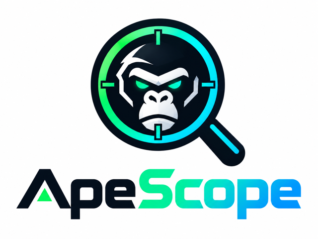
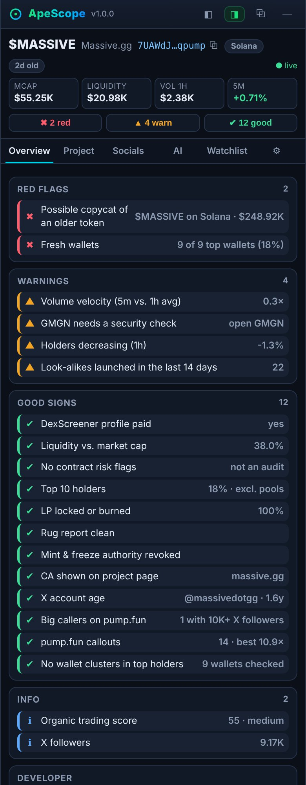
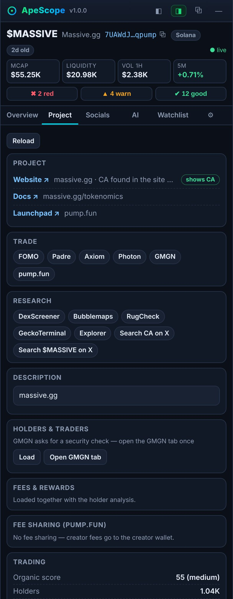
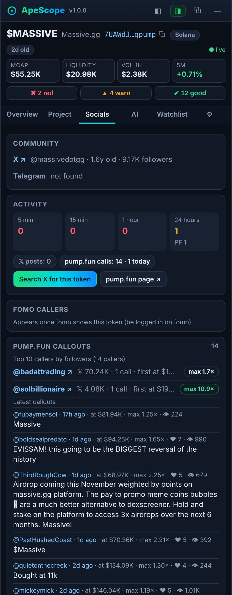
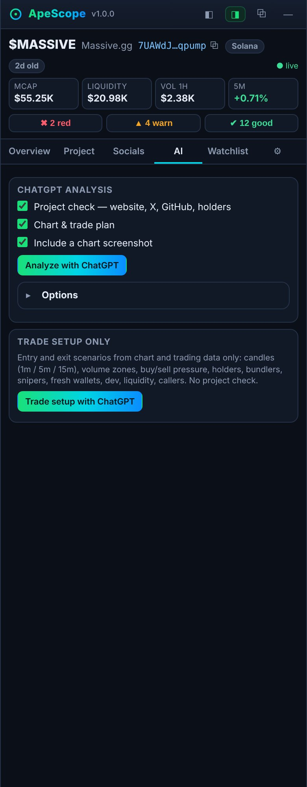
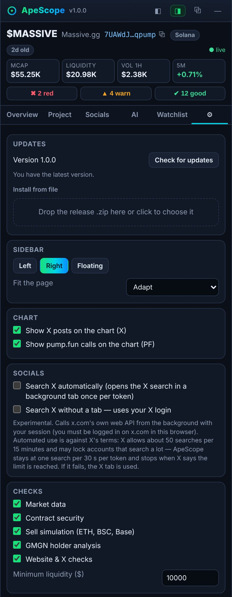

<p align="center"></p>

<h3 align="center">Scope a memecoin before you ape in.</h3>

<p align="center">
A free, open source browser extension for <a href="https://fomo.family"><b>fomo.family</b></a>. It sits next to the fomo chart and shows you what matters before a buy: risk checks, real holders, the developer's track record, callers, copycat tokens and a ChatGPT second opinion. The page moves aside, nothing gets covered.
</p>

<p align="center"><b>🎯 Made for fomo.family.</b> ApeScope currently works on fomo token pages only.<br>More platforms and a native browser side panel may follow, depending on your feedback and how much it gets used.</p>

<p align="center">
  <a href="../../releases/latest/download/apescope-chrome.zip"></a>
  <a href="../../releases/latest/download/apescope-firefox.zip"></a>
</p>

<p align="center">
  
  
  
  
  
</p>

<p align="center">
  <a href="#made-for-fomo">Made for fomo</a> ·
  <a href="#features">Features</a> ·
  <a href="#screenshots">Screenshots</a> ·
  <a href="#install">Install</a> ·
  <a href="#updates">Updates</a> ·
  <a href="#privacy">Privacy</a> ·
  <a href="#faq">FAQ</a> ·
  <a href="#development">Development</a>
</p>

---

## Made for fomo

ApeScope is built around [fomo.family](https://fomo.family): it opens next to the chart of the token you are looking at, follows you from token to token and draws X and pump.fun markers into fomo's chart. On other sites the sidebar does not appear.

What happens next depends on you. If people use it and ask for it, the next steps are a native browser side panel and support for more trading sites. [Open an issue](../../issues) to tell us what you need.

## Features

| | | |
|---|---|---|
| 🚩 **Risk checks**<br>Liquidity against market cap, bump bots, contract flags, LP lock, sell simulation and the rug report, sorted into red flags, warnings and good signs. | 👥 **Real holders**<br>Top 10 without pools and bonding curves, plus bundlers, insiders, snipers, fresh wallets and wallets funded by the same source. | 🧑‍💻 **Developer history**<br>Tokens the dev launched and migrated, whether they sold, who funded the wallet, renamed X accounts and reused logos. Every address is one click away. |
| 📣 **Callers and their reach**<br>fomo theses and pump.fun callouts with the ten biggest callers by followers, the market cap they called at and their best multiple. | 🔎 **Project check**<br>The contract address is searched on the website and on GitHub, also on sites that load it later. A different address on the page is a red flag. | 💸 **Creator fees**<br>Who gets the creator fees, for example a GitHub account, how much came in and how often it was claimed. Read straight from the blockchain. |
| 🧛 **Copycat detection**<br>Tokens with the same or a similar name on any chain, sorted by market cap, with the likely original marked. | ⚡ **Always up to date**<br>Market data every few seconds, buy and sell pressure, holder growth and activity from X, pump.fun and fomo, mostly without extra tabs. | 🤖 **ChatGPT, two ways**<br>A full due diligence prompt that also looks at the meme and its timing, or a pure trade setup with entries, stop and take profit levels. |

Also included: a watchlist with live market caps and alerts, chart markers for X posts and pump.fun calls, clickable links everywhere, and updates from the settings.

## Screenshots

Docked next to the chart. Click a screenshot to see it in full size.

<table>
  <tr>
    <td align="center"><a href="assets/screenshots/overview.jpg"></a><br><sub><b>Overview</b><br>all checks at a glance</sub></td>
    <td align="center"><a href="assets/screenshots/project.jpg"></a><br><sub><b>Project</b><br>website, GitHub, fees</sub></td>
    <td align="center"><a href="assets/screenshots/socials.jpg"></a><br><sub><b>Socials</b><br>callers and activity</sub></td>
    <td align="center"><a href="assets/screenshots/ai.jpg"></a><br><sub><b>AI</b><br>analysis and trade setup</sub></td>
    <td align="center"><a href="assets/screenshots/settings.jpg"></a><br><sub><b>Settings</b><br>updates in one click</sub></td>
  </tr>
</table>

## Install

ApeScope is not in the browser stores yet, so you install it from the [latest release](../../releases/latest). It takes about a minute and you do it once.

### Chrome, Edge, Brave

1. Download [`apescope-chrome.zip`](../../releases/latest/download/apescope-chrome.zip) and unzip it into a folder you keep, for example `Downloads/ApeScope`.
2. Open `chrome://extensions` (Edge: `edge://extensions`, Brave: `brave://extensions`) and switch on **Developer mode** in the corner.
3. Click **Load unpacked** and pick the folder.
4. Pin the ApeScope icon and open any token on [fomo.family](https://fomo.family).

*Developer mode* is only a switch in your browser, no account or registration. It has to stay on, otherwise Chrome turns the extension off. Do not delete the folder, Chrome loads ApeScope from there.

### Firefox 128+

1. Click [`apescope-firefox.xpi`](../../releases/latest/download/apescope-firefox.xpi) in the latest release.
2. Firefox asks whether it may install the add-on from github.com. Click **Continue to installation**, then **Add**.
3. Open any token on [fomo.family](https://fomo.family).

The `.xpi` is signed by Mozilla, stays installed and updates itself. If a release has no `.xpi`, use the zip: open `about:debugging#/runtime/this-firefox`, click **Load Temporary Add-on** and pick `manifest.json` in the unzipped folder (Firefox removes it again when it closes).

**Good to know**

- The holder analysis reads GMGN in the background. If GMGN asks for its security check, open gmgn.ai once and confirm it.
- fomo theses and callers appear when you are logged in on fomo.
- For the AI analysis, be logged in on chatgpt.com and click *Analyze with ChatGPT* in the AI tab.
- X posts are searched in a background tab while you are logged in on x.com. An experimental search without a tab can be switched on under Settings → Socials.

## Updates

- **Firefox (.xpi):** updates install by themselves.
- **Chrome, Edge, Brave:** ApeScope tells you in Settings → *Updates* when a new release is out. Download the new zip and drop it into *Install from file*, ApeScope replaces its files and restarts. This works when ApeScope was loaded from `Downloads/ApeScope`; otherwise unzip the new version over the old folder and click the reload icon on the extensions page.

## Privacy

- No account, no API keys, no ApeScope server. Everything runs in your browser.
- Public data services only see the contract address you look up. Requests from the extension never carry cookies, except to gmgn.ai and x.com, where your own login is used to read data for you.
- No cookies, passwords, wallet keys or session tokens are stored or sent anywhere. ApeScope never connects to your wallet, never signs and never trades.
- The ChatGPT tab is only used after you click *Analyze*.

Full text: [PRIVACY.md](PRIVACY.md).

### Data sources

All free, no API keys.

| Source | Used for |
|---|---|
| DexScreener | market data, paid profile, socials, copycat search, EVM chain detection |
| GoPlus | contract flags, holders, creator, LP holders |
| Honeypot.is | sell simulation on Ethereum, BSC and Base |
| RugCheck | Solana risk summary |
| Jupiter Token API | organic score, verification, dev launches, buy and sell volume, holder change |
| GeckoTerminal | token info, socials, candles |
| pump.fun public API | callouts, bonding curve and pool, fee sharing recipients, caller followers |
| GMGN (with your browser session) | bundlers, insiders, phishing wallets, bots, smart money, KOLs, dev, fees, callouts |
| Solana RPC (Solana Vibe Station or your own) | largest holders, wallet clusters, fresh wallets, fee claims |
| GitHub, FxTwitter, RDAP | repositories, X profiles, domain age |
| fomo, X, pump.fun, ChatGPT | theses, posts, callouts and AI answers, read in your own logged-in tabs |

## FAQ

<details><summary><b>Is it free?</b></summary>

Yes. ApeScope is free and open source under the MIT License.
</details>

<details><summary><b>Does it touch my wallet?</b></summary>

No. ApeScope never connects to a wallet, never asks for approvals and never trades.
</details>

<details><summary><b>Which chains are supported?</b></summary>

Solana gets the most checks (holders, clusters, fresh wallets, pump.fun, fee claims). Ethereum, BSC, Base and the other chains on fomo get market data, contract checks, sell simulation and copycats.
</details>

<details><summary><b>Does it work on other sites than fomo?</b></summary>

Not yet. ApeScope is made for fomo.family. Support for more trading sites and a native browser side panel are planned if enough people use it and ask for it.
</details>

<details><summary><b>Why do I need Developer mode in Chrome?</b></summary>

Chrome only installs extensions from the Chrome Web Store without it. ApeScope is not listed there yet, so it is loaded as an unpacked extension. That is safe: you can read every line of the code in this repository.
</details>

<details><summary><b>Is this financial advice?</b></summary>

No. The checks are signals, not guarantees. Always do your own research.
</details>

## Development

No dependencies, no bundler. Node 18 or newer for tests and the build.

```bash
npm test                                   # all tests (test/*.test.js)
npm run build                              # tests, then dist/chrome, dist/firefox and dist/release/*.zip
node scripts/build.js --github owner/repo  # + update check against that repository's GitHub releases
```

```
src/apescope.js    content script: sidebar on fomo.family, workers on x.com, pump.fun, gmgn.ai, chatgpt.com
src/bridge.js      page-context script: chart markers, chart snapshots, fomo and pump.fun responses
src/compat.js      storage, request and tab API for apescope.js on top of the WebExtension APIs
src/background.js  requests without cookies, GMGN and X requests with the browser session, tabs, updates
scripts/build.js   builds the Chrome and Firefox extension and the release files
assets/            logo, icons, screenshots
docs/              roadmap and technical notes
```

### Releases

1. Raise `version` in `package.json`, `src/apescope.js` and `src/bridge.js` and add a section to `CHANGELOG.md`, commit and push.
2. Run `scripts/release.sh`.

The script runs the tests, builds with the update check pointing at this repository, signs the Firefox build when signing keys are available, tags the version and publishes a GitHub release with `apescope-chrome.zip`, `apescope-firefox.zip` and, when signed, `apescope-firefox.xpi` plus `updates.json` for Firefox's automatic updates.

**Signing**

- **Firefox:** normal Firefox only keeps signed add-ons. Self-distributed ("unlisted") add-ons are signed automatically by addons.mozilla.org, without a store listing or review queue. Put an API key from addons.mozilla.org (*Tools → Manage API Keys*) into `WEB_EXT_API_KEY` and `WEB_EXT_API_SECRET` or `~/.config/apescope/amo.env` before running `scripts/release.sh`.
- **Chrome:** Chrome installs extensions without Developer mode only from the Chrome Web Store, which needs a developer account with a one-time registration fee. Until then the release zip with *Load unpacked* is the way.

## Roadmap

Depending on feedback and usage: a native browser side panel, support for more trading sites, store listings. See [docs/ROADMAP.md](docs/ROADMAP.md) and tell us in the [issues](../../issues) what you need.

## Contributing

Issues and pull requests are welcome. Please run `npm test` before opening a pull request.

## Disclaimer

ApeScope is an independent open source project and is not affiliated with fomo, Padre, Axiom, Photon, DexScreener, GMGN, Jupiter, GoPlus, RugCheck, GeckoTerminal, pump.fun, X or OpenAI. Use at your own risk.

## License

[MIT](LICENSE). Third-party notices: [NOTICE](NOTICE).
